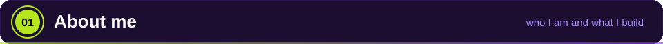
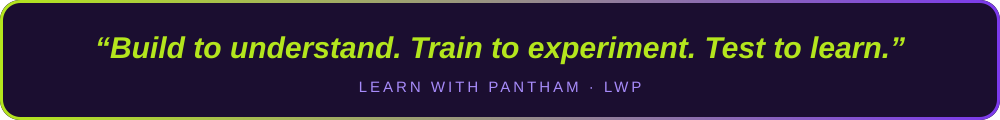

<!--
  SETUP (takes 2 minutes)
  1. This file must live in a repository whose name is exactly your GitHub username (public repo).
  2. Search and replace YOUR_GITHUB_USERNAME with your real username (about 5 places).
  3. Keep the assets/ folder next to this README.md. All animations are self-hosted SVG files.
-->

  

&nbsp;&nbsp;
&nbsp;&nbsp;

  

 

 

- 🏦 **Product Engineer and Team Lead at TCS.** I build backend services for a core banking platform: Trade Finance, Deposits, SWIFT messaging and batch jobs.
- 👥 I lead a team of **8 engineers** through sprints, defect tracking and deliveries.
- 🎬 I run **Learn with Pantham (LWP)**, a new YouTube channel where I teach **AI and Data Engineering** and learn in public.
- 🧠 Right now I am building **LWP SQL-GPT 1.0**: a small GPT-style language model, built **from scratch** with random weights and no pretrained model, to understand how LLMs really work.
- 🩻 I built a **CNN for knee osteoarthritis severity detection** from X-ray images (TensorFlow, TCS AI Hackathon 2025), reaching **81.2% accuracy**.
- 💬 Ask me about: core banking, trade finance, SWIFT, Java and SQL, deep learning basics, and how LLMs are built.

<b>More about my banking and engineering work</b>

 

- Backend REST services for **Trade Finance**: letters of credit and bank guarantees (issuance and amendment).
- **Standing Order Management** in Deposits: outward SWIFT message processing and scheduled batch jobs.
- Contributed to moving a **monolithic core banking platform towards microservices** for better scalability and independent deployments.
- Led daily stand-ups, sprint planning and defect tracking for a team of 8.
- Reviewed and ran database scripts and coordinated smooth, stable deployments.
- **Knee osteoarthritis detection:** CNN with data augmentation, batch normalisation and learning-rate scheduling on a small medical dataset.

 

 

 

 

 

> **LWP SQL-GPT 1.0** is a 12-week, open learning project. I build a tokenizer, a decoder-only Transformer, the training loop and a safe SQL evaluation harness myself, then share **real results, including failures**, in a YouTube series.
>
> 📦 **Code:** [github.com/YOUR_GITHUB_USERNAME/lwp-sql-gpt](https://github.com/YOUR_GITHUB_USERNAME/lwp-sql-gpt)  
> ▶️ **Series:** [Learn with Pantham on YouTube](https://www.youtube.com/channel/UChrvMmag1aRLoKz9QAOTYcQ)

 

 

<!-- These cards come from a free third-party service (github-readme-stats). If they ever fail to load, you can delete this block. -->

 

 

New episode after every milestone. Come and learn with me.

 

&nbsp;&nbsp;
&nbsp;&nbsp;

  

 

© Learn with Pantham (LWP) · Built with HTML and animated SVG

